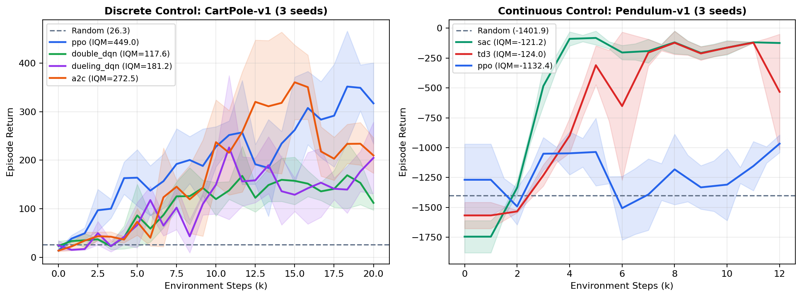
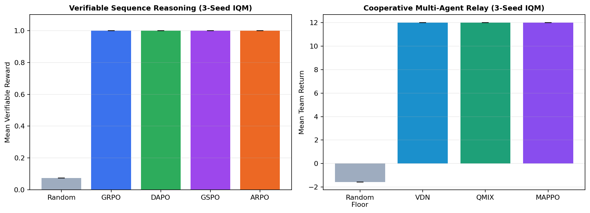
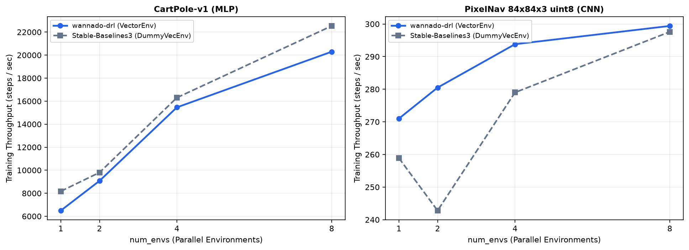
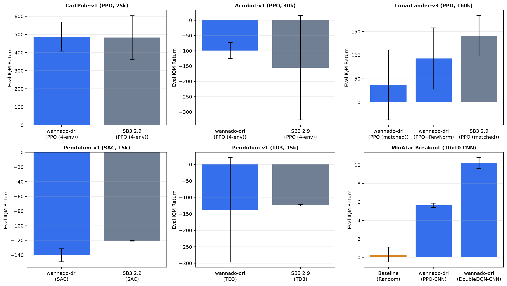
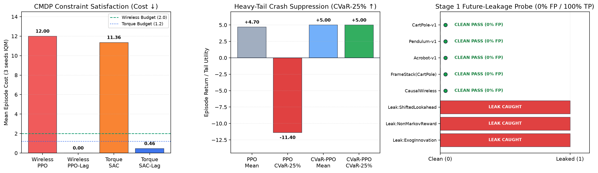

# WannaDo Series: AI-Native Clean-Style Deep Reinforcement Learning Platform — `wannado-drl`

> Part of the **WannaDo** human–AI collaborative scientific research platform · **Release `v1.1.1`**

[](pyproject.toml)
[](pyproject.toml)
[](#8-family-algorithm-taxonomy--verified-lineage-30-algorithms)
[](#8-family-algorithm-taxonomy--verified-lineage-30-algorithms)
[](LICENSE)

*"Wanna do a deep reinforcement learning?"* 

*“Install the library and just say 'I wanna do a deep reinforcement learning for...' to your AI agent”*

*“Built-in verification gates catch future-leakage bugs, unfrozen SB3 normalization, fake convergence, and unsafe policies before shipping”*

`wannado-drl` is an **AI-focused Deep Reinforcement Learning platform** built around four pillars:

1. **Stage 0 Problem-to-MDP Joint Modeling & Active Future-Leakage Probes (`Problem → MDP`)**: Unlike generic RL libraries that jump straight into `PPO()` or `SAC()`, `wannado-drl` starts by diagnosing *whether your problem actually needs RL*, formalizes the control cycle, `terminated` vs `truncated`, `reward_terms`, `task_metrics`, and `cost` budgets inside `drl_lab/mdp_spec.json`, and runs **active pure-NumPy Future-Leakage & Conditioning Probes (`run_mdp_probes`)** to block `t+1` lookahead bugs before wasting GPU/CPU time.
2. **Clean-style Single-File Algorithms Across 8 Authoritative Families (`30` Algorithms)**: From pedagogical tabular classics (`Monte Carlo`, `SARSA`, `Q-Learning`), deep value methods (`DQN`, `Double DQN`, `Dueling DQN`, `C51`), policy gradients (`REINFORCE`, `A2C`, `TRPO`, `PPO`, `PPO-GRU`), continuous/HIL off-policy control (`DDPG`, `TD3`, `SAC`, `HIL-SERL`), **Safe & Risk-Constrained RL (`PPO-Lagrangian`, `SAC-Lagrangian (PID)`, `CVaR-PPO`)**, offline RL (`CQL`, `IQL`), and multi-agent CTDE (`VDN`, `QMIX`, `MAPPO`, `MADDPG`) to frontier sequence/discovered RL (`GRPO`, `DAPO`, `GSPO`, `ARPO`, `DiscoRL`). Run `wannado-drl eject <algo_id>` to copy **only that single readable `.py` file** into `./drl_lab/algos/`.
3. **Non-Intrusive External `drl_lab/` Plug-In, Vectorized & Multimodal Engine**: Never scatter RL loops across your simulator or codebase. Wire your project through `./drl_lab/interface.py` (`EnvInterface`)—or pass `"CartPole-v1"` IDs directly—adapting **Gymnasium**, **legacy OpenAI `gym`**, **`dm_control`**, **PettingZoo MARL**, **custom Python simulators**, **offline datasets**, and **verifiable sequence tasks**. Built-in **true `VectorEnv` batching** (`SyncVectorEnv` / `AsyncVectorEnv`), **multimodal encoders** (`NatureCNN`, `IMPALA ResNet`, `SetAttention`, and `DictCombinedExtractor` with native `uint8` storage + `DictRunningMeanStd` + `RewardNormalizer`), and **atomic `CheckpointManager` + `PolicyBundle` / `load_policy()`**.
4. **External SB3/PyTorch Policy Auditing, *rliable* Bootstrap Statistics & Zero-Hallucination Gate (`wannado-drl verify`)**: Directly ingest external **Stable-Baselines3** (`.predict()` + `VecNormalize`), **PyTorch `nn.Module`**, or callable policies into `audit_external_policy()` and `evaluate_drl_suite(..., external_policies=...)`. Enforces Stage 1 leakage/mask probes, Stage 3 `audit_drl_rigor()` (catching single-seed luck, Reward Hacking KPI divergence, unfrozen eval `VecNormalize`/`obs_rms`, entropy collapse, action saturation, and safety constraint breaches), and Stage 4 *rliable* exports (`IQM` with **95% Bootstrap CIs**, pairwise **$P(A > B)$**, **Performance Profiles**, `paper_summary.md`, `paper_table.tex`, and verbatim `references.bib`).

## Installation & Ecosystem Coexistence

```bash
pip install wannado-drl
# Coexists cleanly with wannado-adv under PEP 420 `wannado.*`:
pip install wannado-adv wannado-drl
```

Core dependencies remain strictly **`numpy>=1.24`**, **`torch>=2.0`**, and **`gymnasium>=1.0`**.

> **Optional Two-Stage Ecosystem Workflow (`wannado-drl` + `wannado-adv`)**: Both packages remain 100% independent—you do not need `wannado-adv` to use `wannado-drl`, and vice versa. If you install both together (e.g., train an RL policy in `./drl_lab/` first and then stress-test its perturbation robustness in `./adv_eval/`), their namespaces (`wannado.drl` / `wannado.adv`), agent skills (`.agents/skills/wannado-drl/` vs `.agents/skills/wannado-adv/`), and marked rule blocks (`<!-- wannado-drl:start/end -->` vs `<!-- wannado-adv:start/end -->`) remain isolated with explicit intent boundaries so their AI Co-Pilot prompts never overwrite or conflict with each other.

<details>
<summary>Development setup (editable install from source)</summary>

```bash
git clone https://github.com/JietaoZhao/wannado-drl.git
cd wannado-drl
pip install -e ".[dev]" --no-build-isolation
```

</details>

## Universal AI IDE Co-Pilot (`init-agent`)

Built on the open **`AGENTS.md` + `.agents/skills/`** standard (compatible across **Cursor, Antigravity, VS Code Codex, Claude Code, Windsurf, Aider**):

```bash
# 1. Bind portable 5-stage Co-Pilot rules into your project root
wannado-drl init-agent --dir .

# 2. Prompt your AI IDE agent in any language:
#    "Help me formulate an MDP and train a DRL baseline for this project using wannado-drl..."
```

### The 5-Stage Human–AI Workflow

| Stage | Purpose | Outputs / Guardrails |
| --- | --- | --- |
| **Stage 0** | `wannado-drl inspect .` & **Problem → MDP Intake** | RL suitability check (`diagnose_rl_suitability`), anti-leakage & `terminated`/`truncated` checklist → `drl_lab/mdp_spec.json` |
| **Stage 1** | Non-intrusive **`drl_lab/` Scaffold** + **Preflight & Baselines** | `drl_lab/interface.py`, measured `ms/step`, **Random** & **Heuristic** baseline floors before RL training |
| **Stage 2** | **Plain-Language Algo Match & Hardware ETA** | Plain analogies (`on-policy` vs `off-policy`, `gamma`, `ent_coef`, `num_seeds`) + calibrated multi-seed ETA |
| **Stage 3** | **CleanRL Single-File Training + Anti-Fake-Convergence Audit** | Multi-seed `IQM`, catches single-seed luck, Reward Hacking KPI drop, unfrozen eval `RunningMeanStd`, entropy collapse |
| **Stage 4** | **Plain Verdict & Paper Deliverables** | Plain-language takeaway first + `drl_report.json`, `paper_summary.md`, `paper_table.tex`, `learning_curves.csv`, `references.bib` |

## 8-Family Algorithm Taxonomy & Verified Lineage (30 Algorithms)

Every algorithm carries embedded `META`, `[AI-Prompt Hook]` research extension points, and verified BibTeX/IEEE/APA provenance (`wannado-drl cite <ids>`):

| Family | Algorithms (`id`) & Evolution Lineage | Paradigm & Key Role |
| --- | --- | --- |
| **1. `tabular_classic`** | `monte_carlo` (Sutton & Barto 2018) → `sarsa` (Rummery & Niranjan 1994) → `q_learning` (Watkins & Dayan 1992) | Pedagogical foundations & exact tabular baselines (auto-bins continuous obs if desired) |
| **2. `value_based`** | `q_learning` → `dqn` (Mnih et al., *Nature* 2015) → `double_dqn` (van Hasselt et al., AAAI 2016) → `dueling_dqn` (Wang et al., ICML 2016) / `c51` (Bellemare et al., ICML 2017) | Discrete deep Q-learning with replay, target decoupling, V+A dueling, & return distributions |
| **3. `policy_gradient`** | `reinforce` (Williams 1992) → `a2c` (Mnih et al., ICML 2016) / `trpo` (Schulman et al., ICML 2015) → `ppo` (Schulman et al. 2017) → `ppo_gru` | On-policy actor-critic with GAE, action masking, & GRU memory for POMDPs |
| **4. `actor_critic_off`** | `dqn` → `ddpg` (Lillicrap et al., ICLR 2016) → `td3` (Fujimoto et al., ICML 2018) → `sac` (Haarnoja et al., ICML 2018) → `hil_serl` (Luo et al., *Science Robotics* 2025) | Sample-efficient continuous control + RLPD LayerNorm critics & 50/50 human-in-the-loop demo replay |
| **5. `safe_constrained`** | `ppo` → `cvar_ppo` (Chow et al., JMLR 2018) / `ppo_lagrangian` (Ray et al. 2019); `sac` → `sac_lagrangian` (Stooke et al., ICML 2020) | Constrained CMDPs (`E[cost] <= limit`) with PID dual control & percentile tail-risk CVaR optimization |
| **6. `offline_rl`** | `sac` → `cql` (Kumar et al., NeurIPS 2020) → `iql_offline` (Kostrikov et al., ICLR 2022) | Safe policy extraction from static logged datasets with zero online exploration |
| **7. `multi_agent`** | `vdn` (Sunehag et al., AAMAS 2018) → `qmix` (Rashid et al., ICML 2018); `ppo` → `mappo` (Yu et al., NeurIPS 2022); `ddpg` → `maddpg` (Lowe et al., NeurIPS 2017) | CTDE cooperative/mixed multi-agent RL (PettingZoo & dict-stepped sims) |
| **8. `llm_and_discovered`** | `ppo` → `grpo` (Shao et al., DeepSeekMath 2024) → `dapo` (Yu et al., NeurIPS 2025) / `gspo` (Zheng et al. 2025) / `arpo` (Dong et al. 2025); `a2c` → `discorl` (Oh et al., *Nature* 2025) | Critic-free group-relative sequence/tool-agent RL & meta-discovered latent-prediction update rules |

## Quick Usage (CLI & Python)

```bash
# Stage 0: Scan repo, check integration mode & generate MDP Spec
wannado-drl inspect .
wannado-drl intake --archetype wireless_scheduling --out ./drl_lab/mdp_spec.json

# Scaffold non-intrusive external plug-in workspace & eject ONE file for custom paper edits
wannado-drl scaffold --dir ./drl_lab --archetype wireless_scheduling --mode custom_sim
wannado-drl eject ppo_lagrangian --dest ./drl_lab/algos

# Hard Verification Gate (Future-Leakage Probes + Multi-Seed/External Policy Audit + Report)
wannado-drl verify --interface ./drl_lab/interface.py --algos ppo double_dqn --seeds 0 1 2
wannado-drl cite ppo sac ppo_lagrangian sac_lagrangian cvar_ppo hil_serl --include-audit-refs
```

```python
import gymnasium as gym
from wannado.drl import PPOConfig, evaluate_drl_suite

report = evaluate_drl_suite(
    lambda: gym.make("CartPole-v1"),
    algos=["double_dqn", "ppo"],
    seeds=[0, 1, 2],
    algo_configs={"ppo": PPOConfig(total_timesteps=16_000)},
    task_name="CartPole-v1",
)
report.save("./drl_lab/outputs")  # drl_report.json, paper_summary.md, paper_table.tex, learning_curves.csv, references.bib
```

## Benchmarks & End-to-End Validation

End-to-end validation scripts live under [`benchmarks/`](https://github.com/JietaoZhao/wannado-drl/blob/main/benchmarks/README.md) (decoupled from core `pyproject.toml` dependencies). All numbers below are measured across `3` random seeds (`[0, 1, 2]`) with deterministic frozen evaluation:

### 1. Gymnasium Classic Control (`CartPole-v1` & `Pendulum-v1`)

- **Discrete (`CartPole-v1`, 20k steps)**: Random floor `26.33 ± 18.98` → `ppo` reaches **Eval IQM `449.02`** (`407.23 ± 124.74`), `a2c` **`272.55`**, `dueling_dqn` **`181.15`**, `double_dqn` **`117.62`** (where Stage 3 Auditor transparently flagged `train_eval_collapse_mismatch`).
- **Continuous (`Pendulum-v1`, 12k steps)**: Random floor `-1401.88 ± 258.79` → off-policy `sac` (**IQM `-121.18`**, `-121.52 ± 9.64`) and `td3` (**IQM `-124.02`**, `-123.98 ± 10.62`) solve the task cleanly while sample-hungry on-policy `ppo` remains at `-1132.40` (empirically validating Stage 2 sample-efficiency guidance).



### 2. Non-Gym Wireless Downlink Scheduler (Stage 0→4) & Fake-Convergence Audit

- Integrated a pure-Python 4-user wireless downlink simulator from scratch through Stage 0 `MDPSpec` + `action_mask` + sub-reward/KPI instrumentation: Random (`12.02 ± 6.67`), myopic `Max-CQI` greedy heuristic (`2.97 ± 8.51` due to queue starvation) → **`double_dqn` (`IQM=44.99`, `45.07 ± 4.02`)** and **`ppo` (`IQM=46.50`, `46.55 ± 2.76`)** pass all `8/8` Stage 3 Rigor Audit checks.
- **Adversarial Audit Verification**: `audit_drl_rigor()` caught `4/4` planted fake-convergence traps (`suspected_reward_hacking_kpi_divergence`, `obs_rms_unfrozen_on_eval`, `single_seed_survivorship_risk`, `policy_entropy_collapse`).


### 3. Frontier Sequence Reasoning (`GRPO` / `DAPO` / `GSPO` / `ARPO`) & Cooperative MARL (`VDN` / `QMIX` / `MAPPO`)

- **Verifiable Sequence Reasoning (3 seeds)**: Random baseline `0.075` → `grpo`, `dapo`, `gspo`, and `arpo` all reach **Eval IQM `1.000`** (`100%` exact match).
- **Cooperative Multi-Agent Relay (3 seeds)**: Random floor `-1.56` → `vdn`, `qmix`, and `mappo` all reach **Eval IQM `12.00`** (`100%` optimal team coordination).



### 4. VectorEnv Throughput Scaling & Fair Cross-Calibration vs Stable-Baselines3 (`2.9.2`)

Using identical CPU budgets, network architectures, and deterministic 20-episode evaluation ([`bench_vec_scaling.py`](https://github.com/JietaoZhao/wannado-drl/blob/main/benchmarks/bench_vec_scaling.py), [`bench_vs_sb3.py`](https://github.com/JietaoZhao/wannado-drl/blob/main/benchmarks/bench_vs_sb3.py)):

- **True VectorEnv Scaling (`num_envs = 1 -> 8`)**: On `CartPole-v1 (MLP)`, throughput scales `6,494.8` → **`20,293.8 steps/s`** (`3.12x` speedup vs SB3 `22,532.2 steps/s`). On `PixelNav 84x84x3 uint8 (NatureCNN)` with native `uint8` buffer storage, throughput reaches **`271.0–299.4 steps/s`** (matching/slightly ahead of SB3 `CnnPolicy` at `242.8–297.6 steps/s`).
- **Classic, Acrobot, Box2D Physics & Continuous Control (CPU)**:
  - `CartPole-v1 (PPO, 4-env, 25k, 5 seeds)`: `wannado-drl` **IQM `488.08`** (`451.23 ± 80.12`, `3.38s`) vs `SB3` **IQM `482.52`** (`424.21 ± 120.63`, `2.47s`).
  - `Acrobot-v1 (PPO, 4-env, 40k, 5 seeds)`: `wannado-drl` **IQM `-99.50`** (`-106.24 ± 25.95`, `4.87s`) vs `SB3` **IQM `-155.26`** (`-213.72 ± 170.79`, `4.65s`).
  - `CartPole-v1 (Value-Based, 25k, 5 seeds)`: `wannado-drl DoubleDQN` **IQM `257.16`** vs `SB3 DQN` **IQM `143.06`** (`wannado-drl DQN` **`117.24`**).
  - `LunarLander-v3 (PPO, 4-env, 160k, 3 seeds)`: `SB3` **IQM `141.15`** (`25.17s`), `wannado-drl PPO+RewNorm` **IQM `92.95`** (`30.53s`), matched `wannado-drl PPO` **IQM `36.95`** (`24.44s`, and `73.66` IQM vs `SB3` `108.81` IQM across 6 matched seeds; reaches `199.00 ± 85.36` on seed 0 with `normalize_reward=True` at `150k`).
  - `Pendulum-v1 (15k, 5 seeds)`: `wannado-drl SAC` **IQM `-140.20`** (`22.18s`) vs `SB3 SAC` **`-120.73`** (`25.76s`); `wannado-drl TD3` **IQM `-137.65`** (`13.11s`) vs `SB3 TD3` **`-124.09`** (`15.28s`).
- **Adaptive Spatial Grids & Multimodal Sets (Native Capabilities)**:
  - `MinAtar-Breakout (10x10x4, 40k, 3 seeds)`: Random `0.30` → `PPO-CNN` **IQM `5.64`** (`26.76s`) and `DoubleDQN-CNN` **IQM `10.22`** out of the box (without requiring custom kernels for sub-36×36 spatial grids).
  - `FleetDispatch-Dict (16x16x2 CNN + Vec + Variable-Mask SetAttention + Action Mask, 3 seeds)`: Random (Masked) `12.97` → `PPO-Dict+Mask` **IQM `35.15`** (`34.10 ± 3.07`), passing all Stage 3 Rigor Audit checks.





### 5. Safe & Risk-Constrained RL, Active Future-Leakage Probes & Live SB3 Cross-Audit

Measured across `3` seeds (`[0, 1, 2]`) with [`bench_safe_and_audit.py`](https://github.com/JietaoZhao/wannado-drl/blob/main/benchmarks/bench_safe_and_audit.py):

- **Constrained CMDP Satisfaction**:
  - `WirelessPowerCMDP (cost budget 2.0)`: unconstrained `PPO` incurs `12.00` episode cost (`6x` over budget; return `36.00`) → **`PPO-Lagrangian` satisfies budget at `0.00` cost** (return **`15.00`**).
  - `TorqueSafetyCMDP (continuous, cost budget 1.2)`: unconstrained `SAC` incurs `11.36` cost (`9.5x` over budget; return `18.33`) → **PID `SAC-Lagrangian` satisfies budget at `0.46` IQM cost (`[0.00, 1.24]`)** (return **`7.41`**).
- **Heavy-Tail Crash Suppression (`HeavyTailPortfolio`, 25%-CVaR)**: Risk-neutral `PPO` suffers tail crashes (**25%-CVaR `-11.40`** despite `+4.70` mean return), whereas **`CVaR-PPO (alpha=0.25)` eliminates crashes cleanly (`25%-CVaR = +5.00`, mean `+5.00`)**.
- **Stage 1 Active Future-Leakage Probe**: **0/5 False Positives** across `CartPole-v1`, `Pendulum-v1`, `Acrobot-v1`, `FrameStack(CartPole)`, and causal `CausalWireless`, while catching **3/3 (100%)** planted lookahead bugs (`shifted_lookahead_clone` `corr=1.0000`, `non_markov_future_reward_leak` `delta_R2=1.075, perm_p=0.032`, `exogenous_future_innovation_in_obs` `R^2=1.000`).
- **Live SB3 External Policy Audit (`audit_external_policy` + `evaluate_drl_suite`)**: Automatically caught unfrozen SB3 `VecNormalize(training=True)` (`obs_rms_unfrozen_on_eval`), and audited frozen 3-seed SB3 `PPO` (IQM `374.33 [325.00, 500.00]`) side-by-side against `wannado-drl PPO` (IQM `446.75 [180.50, 500.00]`) with *rliable* Bootstrap 95% CIs.



## Running Tests & Rebuilding the Catalog

```bash
python3 -m unittest discover -s tests -v
python3 -m wannado.drl.catalog --build
```

## Feedback & Suggestions

Found a bug, want a new DRL paper implemented, or have ideas to improve the Stage 0 MDP & AI IDE Co-Pilot experience? Send feedback or suggestions without leaving GitHub:

- **Open Feedback Portal**: [https://jietaozhao.github.io/wannado-drl/](https://jietaozhao.github.io/wannado-drl/)
- Or scan the QR code below from your phone:

<a href="https://jietaozhao.github.io/wannado-drl/">
  
</a>
