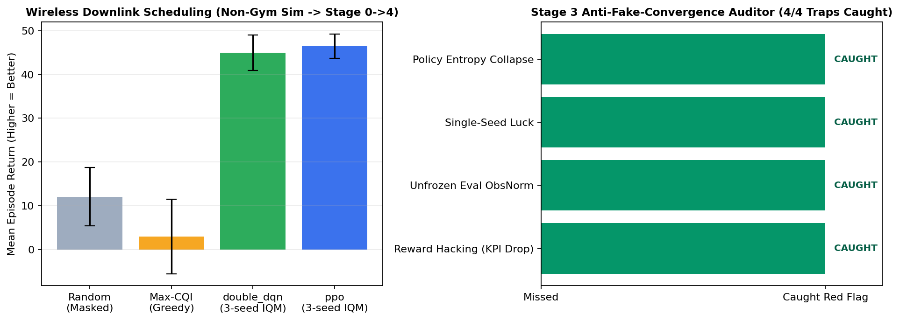

# WannaDo Series: AI-Native Clean-Style Deep Reinforcement Learning Platform — `wannado-drl`

> Part of the **WannaDo** human–AI collaborative scientific research platform · **Release `v1.0.5`**

[](pyproject.toml)
[](pyproject.toml)
[](#7-family-algorithm-taxonomy--verified-lineage-27-algorithms)
[](#7-family-algorithm-taxonomy--verified-lineage-27-algorithms)
[](LICENSE)

*"Wanna do a deep reinforcement learning?"* 

*“Install the library and just say 'I wanna do a deep reinforcement learning for...' to your AI agent”*

*“Built-in automated verification avoid fake convergence and citation hallucinations”*

`wannado-drl` is an **AI-focused Deep Reinforcement Learning platform** built around four pillars:

1. **Stage 0 Problem-to-MDP Joint Modeling (`Problem → MDP`)**: Unlike generic RL libraries that jump straight into `PPO()` or `SAC()`, `wannado-drl` starts by diagnosing *whether your problem actually needs RL*, then helps you formalize the control cycle, state observations (preventing future information leakage), action masking/bounds, `terminated` vs `truncated` boundaries, and sub-reward + domain KPI instrumentation inside `drl_lab/mdp_spec.json`.
2. **Clean-style Single-File Algorithms Across 7 Authoritative Families (`27` Algorithms)**: From pedagogical tabular classics (`Monte Carlo`, `SARSA`, `Q-Learning`) and deep value methods (`DQN` → `Double DQN` → `Dueling DQN` / `C51`) to policy gradients (`REINFORCE` → `A2C` / `TRPO` → `PPO` → `PPO-GRU`), continuous & human-in-the-loop off-policy control (`DDPG` → `TD3` → `SAC` → `HIL-SERL`), offline RL (`CQL`, `IQL`), multi-agent CTDE (`VDN`, `QMIX`, `MAPPO`, `MADDPG`), and frontier reasoning/meta-discovered RL (`GRPO`, `DAPO`, `GSPO`, `ARPO`, `DiscoRL`). Need to implement a new paper? Run `wannado-drl eject <algo_id>` to copy **only that single readable `.py` file** into `./drl_lab/algos/`.
3. **Non-Intrusive External `drl_lab/` Plug-In & Multi-Library Adapters**: Never scatter RL loops across your simulator or codebase. Wire your project through `./drl_lab/interface.py` (`EnvInterface`), which adapts **Gymnasium**, **legacy OpenAI `gym` (4-tuple + `TimeLimit.truncated`)**, **`dm_control` `TimeStep`**, **PettingZoo MARL**, **custom Python simulators**, **static offline datasets**, and **verifiable sequence tasks**.
4. **Anti-Fake-Convergence Auditor & Zero-Hallucination Paper Exports**: Enforces Stage 1 `preflight_env()` (measuring `ms/step` + Random & Heuristic baselines) and Stage 3 `audit_drl_rigor()` (checking multi-seed `mean ± std` & **IQM**, Reward Hacking KPI divergence, unfrozen eval observation normalization, policy entropy collapse, and Critic explained variance) before exporting `drl_report.json`, `paper_summary.md`, `paper_table.tex`, `learning_curves.csv`, and verified `references.bib`.

## Installation & Ecosystem Coexistence

```bash
pip install wannado-drl
# Coexists cleanly with wannado-adv under PEP 420 `wannado.*`:
pip install wannado-adv wannado-drl
```

Core dependencies remain strictly **`numpy>=1.24`**, **`torch>=2.0`**, and **`gymnasium>=1.0`**.

> **Optional Two-Stage Ecosystem Workflow (`wannado-drl` + `wannado-adv`)**: Both packages remain 100% independent—you do not need `wannado-adv` to use `wannado-drl`, and vice versa. If you install both together (e.g., train an RL policy in `./drl_lab/` first and then stress-test its perturbation robustness in `./adv_eval/`), their namespaces (`wannado.drl` / `wannado.adv`), agent skills (`.agents/skills/wannado-drl/` vs `.agents/skills/wannado-adv/`), and marked rule blocks (`<!-- wannado-drl:start/end -->` vs `<!-- wannado-adv:start/end -->`) remain isolated with explicit intent boundaries so their AI Co-Pilot prompts never overwrite or conflict with each other.

<details>
<summary>Development setup (editable install from source)</summary>

```bash
git clone https://github.com/JietaoZhao/wannado-drl.git
cd wannado-drl
pip install -e ".[dev]" --no-build-isolation
```

</details>

## Universal AI IDE Co-Pilot (`init-agent`)

Built on the open **`AGENTS.md` + `.agents/skills/`** standard (compatible across **Cursor, Antigravity, VS Code Codex, Claude Code, Windsurf, Aider**):

```bash
# 1. Bind portable 5-stage Co-Pilot rules into your project root
wannado-drl init-agent --dir .

# 2. Prompt your AI IDE agent in any language:
#    "Help me formulate an MDP and train a DRL baseline for this project using wannado-drl..."
```

### The 5-Stage Human–AI Workflow

| Stage | Purpose | Outputs / Guardrails |
| --- | --- | --- |
| **Stage 0** | `wannado-drl inspect .` & **Problem → MDP Intake** | RL suitability check (`diagnose_rl_suitability`), anti-leakage & `terminated`/`truncated` checklist → `drl_lab/mdp_spec.json` |
| **Stage 1** | Non-intrusive **`drl_lab/` Scaffold** + **Preflight & Baselines** | `drl_lab/interface.py`, measured `ms/step`, **Random** & **Heuristic** baseline floors before RL training |
| **Stage 2** | **Plain-Language Algo Match & Hardware ETA** | Plain analogies (`on-policy` vs `off-policy`, `gamma`, `ent_coef`, `num_seeds`) + calibrated multi-seed ETA |
| **Stage 3** | **CleanRL Single-File Training + Anti-Fake-Convergence Audit** | Multi-seed `IQM`, catches single-seed luck, Reward Hacking KPI drop, unfrozen eval `RunningMeanStd`, entropy collapse |
| **Stage 4** | **Plain Verdict & Paper Deliverables** | Plain-language takeaway first + `drl_report.json`, `paper_summary.md`, `paper_table.tex`, `learning_curves.csv`, `references.bib` |

## 7-Family Algorithm Taxonomy & Verified Lineage (27 Algorithms)

Every algorithm carries embedded `META`, `[AI-Prompt Hook]` research extension points, and verified BibTeX/IEEE/APA provenance (`wannado-drl cite <ids>`):

| Family | Algorithms (`id`) & Evolution Lineage | Paradigm & Key Role |
| --- | --- | --- |
| **1. `tabular_classic`** | `monte_carlo` (Sutton & Barto 2018) → `sarsa` (Rummery & Niranjan 1994) → `q_learning` (Watkins & Dayan 1992) | Pedagogical foundations & exact tabular baselines (auto-bins continuous obs if desired) |
| **2. `value_based`** | `q_learning` → `dqn` (Mnih et al., *Nature* 2015) → `double_dqn` (van Hasselt et al., AAAI 2016) → `dueling_dqn` (Wang et al., ICML 2016) / `c51` (Bellemare et al., ICML 2017) | Discrete deep Q-learning with replay, target decoupling, V+A dueling, & return distributions |
| **3. `policy_gradient`** | `reinforce` (Williams 1992) → `a2c` (Mnih et al., ICML 2016) / `trpo` (Schulman et al., ICML 2015) → `ppo` (Schulman et al. 2017) → `ppo_gru` | On-policy actor-critic with GAE, action masking, & GRU memory for POMDPs |
| **4. `actor_critic_off`** | `dqn` → `ddpg` (Lillicrap et al., ICLR 2016) → `td3` (Fujimoto et al., ICML 2018) → `sac` (Haarnoja et al., ICML 2018) → `hil_serl` (Luo et al., *Science Robotics* 2025) | Sample-efficient continuous control + RLPD LayerNorm critics & 50/50 human-in-the-loop demo replay |
| **5. `offline_rl`** | `sac` → `cql` (Kumar et al., NeurIPS 2020) → `iql_offline` (Kostrikov et al., ICLR 2022) | Safe policy extraction from static logged datasets with zero online exploration |
| **6. `multi_agent`** | `vdn` (Sunehag et al., AAMAS 2018) → `qmix` (Rashid et al., ICML 2018); `ppo` → `mappo` (Yu et al., NeurIPS 2022); `ddpg` → `maddpg` (Lowe et al., NeurIPS 2017) | CTDE cooperative/mixed multi-agent RL (PettingZoo & dict-stepped sims) |
| **7. `llm_and_discovered`** | `ppo` → `grpo` (Shao et al., DeepSeekMath 2024) → `dapo` (Yu et al., NeurIPS 2025) / `gspo` (Zheng et al. 2025) / `arpo` (Dong et al. 2025); `a2c` → `discorl` (Oh et al., *Nature* 2025) | Critic-free group-relative sequence/tool-agent RL & meta-discovered latent-prediction update rules |

## Quick Usage (CLI & Python)

```bash
# Stage 0: Scan repo, check integration mode & surface MDP intake questions
wannado-drl inspect .

# Generate & audit an initial Stage 0 MDP Spec
wannado-drl intake --archetype wireless_scheduling --out ./drl_lab/mdp_spec.json

# Scaffold non-intrusive external plug-in workspace & eject ONE file for custom paper edits
wannado-drl scaffold --dir ./drl_lab --archetype wireless_scheduling --mode custom_sim
wannado-drl eject ppo --dest ./drl_lab/algos

# Stage 1 preflight (speed + Random/Heuristic floors) & zero-hallucination citations
wannado-drl preflight --interface ./drl_lab/interface.py
wannado-drl cite ppo sac hil_serl grpo dapo gspo arpo discorl --include-audit-refs
```

```python
import gymnasium as gym
from wannado.drl import PPOConfig, evaluate_drl_suite

report = evaluate_drl_suite(
    lambda: gym.make("CartPole-v1"),
    algos=["double_dqn", "ppo"],
    seeds=[0, 1, 2],
    algo_configs={"ppo": PPOConfig(total_timesteps=16_000)},
    task_name="CartPole-v1",
)
report.save("./drl_lab/outputs")  # drl_report.json, paper_summary.md, paper_table.tex, learning_curves.csv, references.bib
```

## Benchmarks & End-to-End Validation

End-to-end validation scripts live under [`benchmarks/`](https://github.com/JietaoZhao/wannado-drl/blob/main/benchmarks/README.md) (decoupled from core `pyproject.toml` dependencies). All numbers below are measured across `3` random seeds (`[0, 1, 2]`) with deterministic frozen evaluation:

### 1. Gymnasium Classic Control (`CartPole-v1` & `Pendulum-v1`)

- **Discrete (`CartPole-v1`, 20k steps)**: Random floor `26.33 ± 18.98` → `ppo` reaches **Eval IQM `449.02`** (`407.23 ± 124.74`), `a2c` **`272.55`**, `dueling_dqn` **`181.15`**, `double_dqn` **`117.62`** (where Stage 3 Auditor transparently flagged `train_eval_collapse_mismatch`).
- **Continuous (`Pendulum-v1`, 12k steps)**: Random floor `-1401.88 ± 258.79` → off-policy `sac` (**IQM `-121.18`**, `-121.52 ± 9.64`) and `td3` (**IQM `-124.02`**, `-123.98 ± 10.62`) solve the task cleanly while sample-hungry on-policy `ppo` remains at `-1132.40` (empirically validating Stage 2 sample-efficiency guidance).


### 2. Non-Gym Wireless Downlink Scheduler (Stage 0→4) & Fake-Convergence Audit

- Integrated a pure-Python 4-user wireless downlink simulator from scratch through Stage 0 `MDPSpec` + `action_mask` + sub-reward/KPI instrumentation: Random (`12.02 ± 6.67`), myopic `Max-CQI` greedy heuristic (`2.97 ± 8.51` due to queue starvation) → **`double_dqn` (`IQM=44.99`, `45.07 ± 4.02`)** and **`ppo` (`IQM=46.50`, `46.55 ± 2.76`)** pass all `8/8` Stage 3 Rigor Audit checks.
- **Adversarial Audit Verification**: `audit_drl_rigor()` caught `4/4` planted fake-convergence traps (`suspected_reward_hacking_kpi_divergence`, `obs_rms_unfrozen_on_eval`, `single_seed_survivorship_risk`, `policy_entropy_collapse`).



### 3. Frontier Sequence Reasoning (`GRPO` / `DAPO` / `GSPO` / `ARPO`) & Cooperative MARL (`VDN` / `QMIX` / `MAPPO`)

- **Verifiable Sequence Reasoning (3 seeds)**: Random baseline `0.075` → `grpo`, `dapo`, `gspo`, and `arpo` all reach **Eval IQM `1.000`** (`100%` exact match).
- **Cooperative Multi-Agent Relay (3 seeds)**: Random floor `-1.56` → `vdn`, `qmix`, and `mappo` all reach **Eval IQM `12.00`** (`100%` optimal team coordination).


## Running Tests & Rebuilding the Catalog

```bash
python3 -m unittest discover -s tests -v
python3 -m wannado.drl.catalog --build
```

## Feedback & Suggestions

Found a bug, want a new DRL paper implemented, or have ideas to improve the Stage 0 MDP & AI IDE Co-Pilot experience? Send feedback or suggestions without leaving GitHub:

- **Open Feedback Portal**: [https://jietaozhao.github.io/wannado-drl/](https://jietaozhao.github.io/wannado-drl/)
- Or scan the QR code below from your phone:

<a href="https://jietaozhao.github.io/wannado-drl/">
  
</a>
